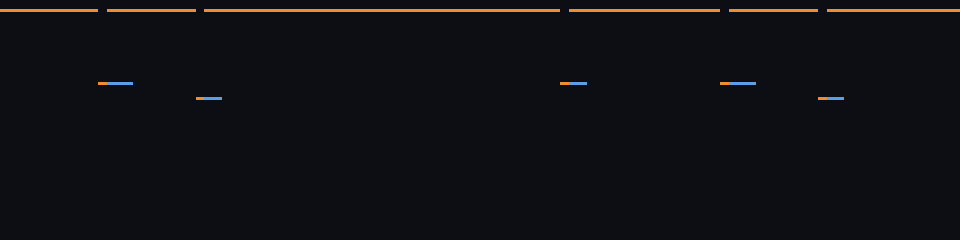

# SONOVA-ROCK-HEAL-0001 — Broken Strings, Living Band

自動生成: `npm run rock:series`。音声 `output/rock-series/SONOVA-ROCK-HEAL-0001.wav` / `.mid`（Git 管理外、同じシードで再生成）。

- 162 BPM · C minor · 2:44 · シード `sonova-rock-heal-0001` · 検証 OK (peak -1 dBFS, RMS -13.452 dBFS)
- バンドは SONOVA-ROCK-0001 と同じ: ギター ← 木の年輪 / ドラム ← 建物の外壁 / ベースとリード ← 夕焼けの海

| 決めたこと | 値 | 元 | 理由 |
|---|---|---|---|
| key | C minor | bark.pitch_range.root_pc | ギターになった素材の主音。ロックなので自然短音階 |
| bpm | 162 | series | ライブの勢い: 元のテンポ 145 の 1.12 倍 |

## 原理（SONOVA 003 のロック版）: 音楽が自分を修復する

バンドに 5 つの故障を仕込み、聴き手が毎小節の**実際の音声**を楽譜と照らして聴く。欠落なら別の楽器が役を引き受け、半音ずれならベースが根音を変えて間違った音を和音の音にする。戻ったのを聴いたら補完をやめる。
比較用に修復なし版 `SONOVA-ROCK-HEAL-0001.broken.wav` (検証 OK) も書き出す。

| 故障 | 区間 | 小節 | 内容 |
|---|---|---|---|
| guitar dropout | verse1 | 11–14 | ギターのケーブルが抜ける |
| lead wrong | chorus1 | 22–24 | リードが半音ずれて弾く |
| lead dropout | solo | 62–65 | ソロの途中でリードの弦が切れる |
| bass dropout | chorus3 | 81–84 | ベースのアンプが落ちる |
| lead wrong | chorus4 | 92–94 | 最後のサビでリードがまた半音ずれる |

小節ごとの健全度（橙 = 修復あり、青 = 修復なし）。故障中の平均: 修復あり **0.900** / 修復なし **0.663**。

### 聴き手の記録

- 0:16 (小節 11) **fault** guitar: ギターのケーブルが抜ける (4 小節、故障の注入)
- 0:16 (小節 11) **detect** guitar: guitar が聴こえない (基準より -83.4 dB)
- 0:17 (小節 12) **repair** guitar ← lead: リードギターがリフとコードを弾いて穴を埋める
- 0:22 (小節 15) **recover** guitar ← lead: guitar が戻ったのを聴いて lead は元の役に戻る
- 0:32 (小節 22) **fault** lead: リードが半音ずれて弾く (3 小節、故障の注入)
- 0:32 (小節 22) **detect** lead: リードの半音隣りが 18.6 dB 強い → E がずれている
- 0:34 (小節 23) **repair** lead ← bass: ベースが根音を C に変え、E を和音の音にする
- 0:37 (小節 25) **recover** lead ← bass: ずれが消えたのを聴いてベースは元の根音に戻る
- 1:31 (小節 62) **fault** lead: ソロの途中でリードの弦が切れる (4 小節、故障の注入)
- 1:33 (小節 63) **detect** lead: lead が聴こえない (基準より -100.4 dB)
- 1:34 (小節 64) **repair** lead ← guitar: リズムギターがリードのメロディを引き受ける
- 1:37 (小節 66) **recover** lead ← guitar: lead が戻ったのを聴いて guitar は元の役に戻る
- 2:00 (小節 81) **fault** bass: ベースのアンプが落ちる (4 小節、故障の注入)
- 2:00 (小節 81) **detect** bass: bass が聴こえない (基準より -90.4 dB)
- 2:01 (小節 82) **repair** bass ← guitar: ギターがベースラインを低い弦で弾く
- 2:05 (小節 85) **recover** bass ← guitar: bass が戻ったのを聴いて guitar は元の役に戻る
- 2:16 (小節 92) **fault** lead: 最後のサビでリードがまた半音ずれる (3 小節、故障の注入)
- 2:16 (小節 92) **detect** lead: リードの半音隣りが 19.7 dB 強い → E がずれている
- 2:17 (小節 93) **repair** lead ← bass: ベースが根音を C に変え、E を和音の音にする
- 2:20 (小節 95) **recover** lead ← bass: ずれが消えたのを聴いてベースは元の根音に戻る
