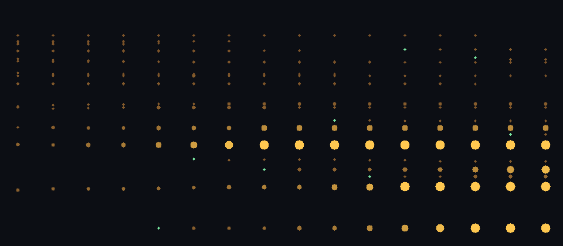

# SONOVA-GROW-0001 — 音が楽器を育てる

自動生成: `npm run s002`。音声 `output/s002/SONOVA-GROW-0001.wav`（83秒）、育つ前と後の打音 `.strike-before.wav` / `.strike-after.wav`。

**原理**: 外壁の画像から作った「共鳴する板」（17 モード）を、木の楽器（旋律）と夕焼けの楽器（ドローン）が鳴らし、板自身も拍ごとに打たれる。
板は 2 小節ごとに自分の鳴り方を聴いて変わる。

| 規則 | 条件 | 変化 | 回数 |
|---|---|---|---|
| grow | よく鳴った上位 25% のモード | 響きが 1.25 倍長く、少し大きく | 64 |
| tune | 中央値以上に鳴ったモード | 弾かれた音 (とその倍音) に 35% 近づく | 74 |
| starve | 鳴らなかった下位 25% | 響きが短く、小さく | 52 |
| reborn | 響きが 0.12 秒を切ったモード | 死んで、聴こえた音のピークのうち楽器にない周波数で生まれ直す | 12 |

次のフレーズの旋律は、板のいちばん強いモードから選ぶ（15% は5度跳ぶ「好奇心」）。楽器が旋律を変え、旋律が楽器を変える。

横 = 世代、縦 = 周波数 (対数)、明るさ = 響きの長さ × 大きさ、緑 = 生まれ直したモード。

| 世代 | 調和度 | 平均の響き | 最低の強いモード | 強いモードの音名の種類 | 旋律 |
|---|---|---|---|---|---|
| 0 | 0.684 | 0.38s | 185.0Hz | 5 | G D# A# C F D# C A# A# C A# G |
| 1 | 0.528 | 0.40s | 188.8Hz | 5 | C G E F# D# F# E G G C E D# |
| 2 | 0.498 | 0.43s | 188.8Hz | 4 | C G F# G C D# F# G C F# C# G |
| 3 | 0.511 | 0.45s | 188.8Hz | 4 | G G D G C D# F# G F# C F# A# |
| 4 | 0.635 | 0.50s | 97.8Hz | 4 | F# G G C G G D# D# D# F# G C |
| 5 | 0.679 | 0.55s | 97.8Hz | 4 | G G G A# D G G C G F# G A# |
| 6 | 0.764 | 0.59s | 97.9Hz | 3 | F C G G G F# G G C D# G G |
| 7 | 0.668 | 0.70s | 97.9Hz | 3 | G C C# G F G G D# G G C G |
| 8 | 0.666 | 0.74s | 97.9Hz | 3 | G G C D# G G G C C G G C |
| 9 | 0.691 | 0.80s | 97.9Hz | 3 | A# A# G D A# C C G G C C A# |
| 10 | 0.590 | 0.88s | 97.9Hz | 4 | C C G G C C G C G C C G |
| 11 | 0.603 | 0.98s | 97.9Hz | 3 | C G C F F C F C C F G G |
| 12 | 0.603 | 1.07s | 97.9Hz | 3 | C G A# G C C A# G G G G G |
| 13 | 0.603 | 1.15s | 97.9Hz | 3 | C C G A# A# C G G G F A# G |
| 14 | 0.580 | 1.27s | 97.9Hz | 3 | G C G A# C D# C D A# G G C |
| 15 | 0.576 | 1.38s | 97.9Hz | 3 | G F G C G D# C G A# C C G |

調和度 = 強い 8 モードが最低モードの整数倍にどれだけ近いか (1 = 完全な倍音列)。

## 変化の記録（抜粋）

- 世代 3: **reborn** #13 2109.6Hz (死) → #17 97.8Hz — 聴こえたスペクトルのピーク 97.8Hz に楽器のモードがなかった
- 世代 4: **reborn** #14 2161.0Hz (死) → #18 311.9Hz — 聴こえたスペクトルのピーク 311.9Hz に楽器のモードがなかった
- 世代 6: **reborn** #11 1885.8Hz (死) → #19 262.2Hz — 聴こえたスペクトルのピーク 262.2Hz に楽器のモードがなかった
- 世代 6: **reborn** #15 2228.2Hz (死) → #20 262.2Hz — 聴こえたスペクトルのピーク 262.2Hz に楽器のモードがなかった
- 世代 8: **reborn** #12 1897.0Hz (死) → #21 594.2Hz — 聴こえたスペクトルのピーク 594.2Hz に楽器のモードがなかった
- 世代 9: **reborn** #8 1287.1Hz (死) → #22 232.9Hz — 聴こえたスペクトルのピーク 232.9Hz に楽器のモードがなかった
- 世代 10: **reborn** #10 1578.9Hz (死) → #23 1934.5Hz — 聴こえたスペクトルのピーク 1934.5Hz に楽器のモードがなかった
- 世代 12: **reborn** #6 1098.0Hz (死) → #24 1685.9Hz — 聴こえたスペクトルのピーク 1685.9Hz に楽器のモードがなかった
- 世代 13: **reborn** #5 1094.3Hz (死) → #25 468.3Hz — 聴こえたスペクトルのピーク 468.3Hz に楽器のモードがなかった
- 世代 13: **reborn** #16 2463.9Hz (死) → #26 468.3Hz — 聴こえたスペクトルのピーク 468.3Hz に楽器のモードがなかった
- 世代 0: tune #0 185.0Hz → 188.8Hz — 弾かれた音 196.0Hz に 100 セント引き寄せ
- 世代 0: tune #1 397.6Hz → 395.8Hz — 弾かれた音 392.4Hz に -23 セント引き寄せ
- 世代 0: tune #2 527.4Hz → 525.9Hz — 弾かれた音 523.3Hz に -14 セント引き寄せ
- 世代 0: tune #3 740.0Hz → 725.5Hz — 弾かれた音 699.2Hz に -98 セント引き寄せ
- 世代 0: tune #4 751.9Hz → 763.0Hz — 弾かれた音 784.0Hz に 72 セント引き寄せ
- 世代 0: tune #7 1248.0Hz → 1246.8Hz — 弾かれた音 1244.5Hz に -5 セント引き寄せ
- 世代 0: tune #8 1310.6Hz → 1287.1Hz — 弾かれた音 1244.5Hz に -90 セント引き寄せ
- 世代 0: tune #9 1590.4Hz → 1582.5Hz — 弾かれた音 1568.0Hz に -25 セント引き寄せ

全 202 件は `SONOVA-GROW-0001.json` の `changes`。検証: OK · peak -3.17 dBFS · RMS -16 dBFS。
