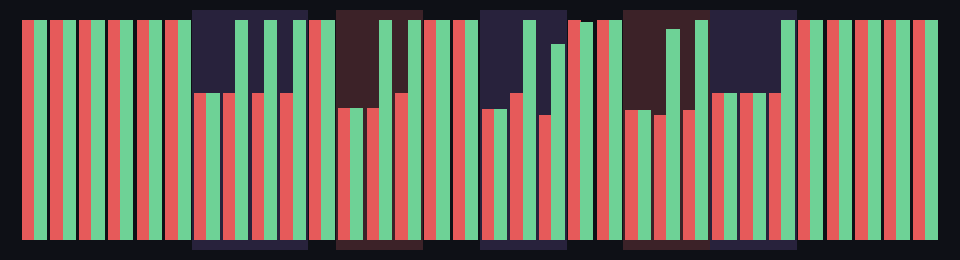

# SONOVA-HEAL-0001 — 音楽が自分を修復する

自動生成: `npm run s003`。修復あり `output/s003/SONOVA-HEAL-0001.wav`、比較用の修復なし `SONOVA-HEAL-0001.broken.wav`（どちらも 81 秒、同じ故障）。

**原理**: 夕焼け (ベース)・外壁 (和音)・木 (旋律) が C minor の i–bVI–bIII–bVII を演奏する。シードで決まる故障が「欠落」と「不協和」を起こす。
聴き手は 1 小節ごとに**実際にレンダリングされた音声**を FFT で聴き、楽譜と照らして判断する（故障の情報は読まない）。

- 欠落の検出: 各パートが楽譜で弾くはずの音高のエネルギーが、健全な小節の中央値より 10 dB 以上低い
- 不協和の検出: 元の和音にも調にもない音高のエネルギーが 12% (または普段 + 10%) を超える
- 修復 (1 小節後から): 旋律の欠落 → 和音の楽器が 1 オクターブ下で引き受ける / ベースの欠落 → 和音の楽器が根音を弾く / 和音の欠落 → 旋律の楽器がアルペジオ / 不協和 → ベースが根音を変えて、ずれた音を和音の音にする
- 回復: 元のパートの音高が戻った (または ずれが消えた) のを聴いたら補完をやめる

小節ごとの健全度（赤 = 修復なし、緑 = 修復あり、紫の帯 = 欠落、赤い帯 = 不協和の故障区間）。

| | 修復なし | 修復あり |
|---|---|---|
| 健全度の平均 (全体) | 0.816 | 0.926 |
| 健全度の平均 (故障区間 + 1 小節) | 0.705 | 0.881 |

健全度 = 1 − 欠けたパート数/3 − 不協和なら 0.4 − 鳴っている和声の外の音の比率。

## 故障・検出・修復・回復の記録

| 小節 | 種類 | 内容 |
|---|---|---|
| 6 | fault | melody が 4 小節消える (故障の注入) |
| 6 | detect | melody の音が楽譜の音高で -14.2 dB 足りない (欠落) |
| 7 | repair | pad が melody のパートを1オクターブ下で引き受ける (← #1) |
| 10 | recover | melody が戻ったのを聴いて pad は補完をやめる (← #1) |
| 11 | fault | melody が 3 小節、半音ずれた音を弾く (故障の注入) |
| 11 | detect | melody の楽譜の音より半音隣りが 30.0 dB 強い → G# がずれている (不協和) |
| 12 | repair | bass が根音を F に変え、ずれた音を和音の音にする (リハーモナイズ) (← #5) |
| 14 | recover | ずれが消えたのを聴いて bass は元の和声に戻る (← #5) |
| 16 | fault | bass が 3 小節消える (故障の注入) |
| 16 | detect | bass の音が楽譜の音高で -25.2 dB 足りない (欠落) |
| 17 | repair | pad が bass のパートを1オクターブ上で引き受ける (← #9) |
| 19 | recover | bass が戻ったのを聴いて pad は補完をやめる (← #9) |
| 21 | fault | pad が 3 小節、半音ずれた音を弾く (故障の注入) |
| 21 | detect | pad の楽譜の音より半音隣りが 16.0 dB 強い → C# がずれている (不協和) |
| 22 | repair | bass が根音を D# に変え、ずれた音を和音の音にする (リハーモナイズ) (← #13) |
| 24 | fault | pad が 3 小節消える (故障の注入) |
| 24 | recover | ずれが消えたのを聴いて bass は元の和声に戻る (← #13) |
| 25 | detect | pad の音が楽譜の音高で -17.0 dB 足りない (欠落) |
| 26 | repair | melody が和音をアルペジオで補う (← #17) |
| 27 | recover | pad が戻ったのを聴いて melody は補完をやめる (← #17) |

検出 5 回、修復 5 回、回復 5 回。注入した故障は 5 件:
melody の欠落 (小節 6〜9)、melody の不協和 (小節 11〜13)、bass の欠落 (小節 16〜18)、pad の不協和 (小節 21〜23)、pad の欠落 (小節 24〜26)。
