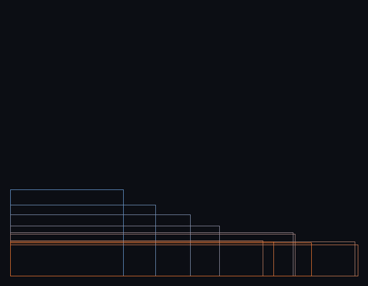

# SONOVA-SPACE-0001 — 音が空間を作る

自動生成: `npm run s004`。音声 `output/s004/SONOVA-SPACE-0001.wav`（77 秒）、部屋の 3D アニメーション [`SONOVA-SPACE-0001.gltf`](SONOVA-SPACE-0001.gltf)（Blender / three.js で開ける）。

**原理**: 直方体の部屋が楽器であり楽譜でもある。

- **空間 → 音**: 部屋の共鳴モード f = c/2·√((nx/Lx)²+(ny/Ly)²+(nz/Lz)²) を、そのまま (12平均律に丸めず) 旋律とドローンの音高にする。旋律の音源から聴き手までの**初期反射の到着時刻**の並びを 16 分のリズムにする。すべての音を部屋の中で鳴らす (2 つの耳への鏡像音源 3 次反射 + Sabine の残響時間に合わせた残響)
- **音 → 空間**: 生成ごとに聴こえた音の低音・中音・高音の比率と明るさを測り、低音 → 幅 (Lx)、中音 → 奥行き (Ly)、高音 → 天井 (Lz)、明るさ → 壁の硬さ (吸音率) を変える。変形した部屋が次の音高とリズムを決める

最初の部屋: room.L = 9.728 × 7.461 × 3.601 (外壁の格子の規則性と共鳴 → 部屋の幅・奥行き・高さ)、room.absorption = 0.303 (表面の粗さ → 壁の吸音率)。

上から見た部屋の変化（青 = 最初 → 橙 = 最後）。

| 生成 | 幅×奥行き×高さ (m) | 吸音率 | RT60 | ドローン (モード) | リズム (16分の位置) | 聴こえた 低/中/高 |
|---|---|---|---|---|---|---|
| 0 | 9.73 × 7.46 × 3.60 | 0.30 | 0.52s | 70.5 Hz (1,0,0) | 0 4 6 12 13 14 15 | 61 / 32 / 7 % |
| 1 | 9.73 × 7.46 × 3.60 | 0.30 | 0.52s | 70.5 Hz (1,0,0) | 0 4 6 12 13 14 15 | 74 / 20 / 6 % |
| 2 | 12.50 × 6.13 × 3.58 | 0.33 | 0.46s | 109.8 Hz (1,0,0) | 0 4 6 10 12 13 14 15 | 76 / 19 / 5 % |
| 3 | 15.50 × 5.28 × 3.59 | 0.36 | 0.42s | 88.5 Hz (1,0,0) | 0 4 6 8 9 11 12 13 14 15 | 77 / 15 / 8 % |
| 4 | 18.01 × 4.33 × 3.98 | 0.32 | 0.47s | 76.2 Hz (1,0,0) | 0 3 5 6 7 8 11 14 15 | 89 / 8 / 3 % |
| 5 | 24.37 × 3.75 × 3.79 | 0.40 | 0.36s | 112.6 Hz (1,0,0) | 0 3 4 5 6 7 10 12 15 | 77 / 18 / 6 % |
| 6 | 24.54 × 3.61 × 3.77 | 0.36 | 0.38s | 111.8 Hz (1,0,0) | 0 3 4 6 7 9 10 11 15 | 85 / 10 / 5 % |
| 7 | 29.70 × 2.97 × 3.75 | 0.37 | 0.34s | 92.4 Hz (1,0,0) | 0 3 4 6 7 9 10 15 | 68 / 23 / 10 % |
| 8 | 21.74 × 3.06 × 3.92 | 0.25 | 0.51s | 63.1 Hz (1,0,0) | 0 3 4 7 8 10 11 15 | 89 / 8 / 3 % |
| 9 | 29.95 × 2.70 × 3.75 | 0.33 | 0.37s | 91.6 Hz (1,0,0) | 0 3 4 7 8 9 11 15 | 68 / 24 / 9 % |
| 10 | 22.69 × 2.97 × 3.92 | 0.26 | 0.50s | 120.9 Hz (1,0,0) | 0 3 4 7 8 9 11 15 | 81 / 14 / 4 % |
| 11 | 25.96 × 2.86 × 3.82 | 0.27 | 0.45s | 105.7 Hz (1,0,0) | 0 3 4 7 8 9 11 15 | 83 / 10 / 8 % |

旋律の音は部屋のモードなので 12 平均律からずれる (例: 生成 0 の最初の 6 音 367.8Hz (-10¢), 336.7Hz (+37¢), 336.7Hz (+37¢), 367.8Hz (-10¢), 196.9Hz (+8¢), 203.1Hz (-38¢))。

## 変形の記録（抜粋）

- 生成 1: Lx (幅) 9.728 → 12.497 — 低音の比率 74.3% (平均との差 13.0pt)、音量 +1.2 dB → 体積 5.1%
- 生成 1: Ly (奥行き) 7.461 → 6.134 — 中音の比率 20.0% (差 -12.1pt)、音量 +1.2 dB → 体積 5.1%
- 生成 1: Lz (天井) 3.601 → 3.582 — 高音の比率 5.8% (差 -0.8pt)、音量 +1.2 dB → 体積 5.1%
- 生成 1: absorption (吸音) 0.303 → 0.332 — 音の重心 425Hz (平均 507Hz): いつもより明るいと壁が硬く、暗いと柔らかくなる
- 生成 2: Lx (幅) 12.497 → 15.502 — 低音の比率 76.4% (平均との差 8.6pt)、音量 +1.7 dB → 体積 7.2%
- 生成 2: Ly (奥行き) 6.134 → 5.283 — 中音の比率 18.6% (差 -7.5pt)、音量 +1.7 dB → 体積 7.2%
- 生成 2: Lz (天井) 3.582 → 3.594 — 高音の比率 4.9% (差 -1.3pt)、音量 +1.7 dB → 体積 7.2%
- 生成 2: absorption (吸音) 0.332 → 0.362 — 音の重心 395Hz (平均 466Hz): いつもより明るいと壁が硬く、暗いと柔らかくなる
- 生成 3: Lx (幅) 15.502 → 18.007 — 低音の比率 77.4% (平均との差 6.7pt)、音量 +1.3 dB → 体積 5.3%
- 生成 3: Ly (奥行き) 5.283 → 4.327 — 中音の比率 14.8% (差 -8.8pt)、音量 +1.3 dB → 体積 5.3%
- 生成 3: Lz (天井) 3.594 → 3.978 — 高音の比率 7.8% (差 2.0pt)、音量 +1.3 dB → 体積 5.3%
- 生成 3: absorption (吸音) 0.362 → 0.32 — 音の重心 528Hz (平均 442Hz): いつもより明るいと壁が硬く、暗いと柔らかくなる
- 生成 4: Lx (幅) 18.007 → 24.367 — 低音の比率 88.9% (平均との差 16.5pt)、音量 +2.8 dB → 体積 11.8%
- 生成 4: Ly (奥行き) 4.327 → 3.747 — 中音の比率 7.8% (差 -13.6pt)、音量 +2.8 dB → 体積 11.8%
- 生成 4: Lz (天井) 3.978 → 3.794 — 高音の比率 3.3% (差 -3.0pt)、音量 +2.8 dB → 体積 11.8%
- 生成 4: absorption (吸音) 0.32 → 0.396 — 音の重心 281Hz (平均 464Hz): いつもより明るいと壁が硬く、暗いと柔らかくなる

全 44 件は `SONOVA-SPACE-0001.json`。検証: OK · peak -1 dBFS · RMS -17.014 dBFS。
